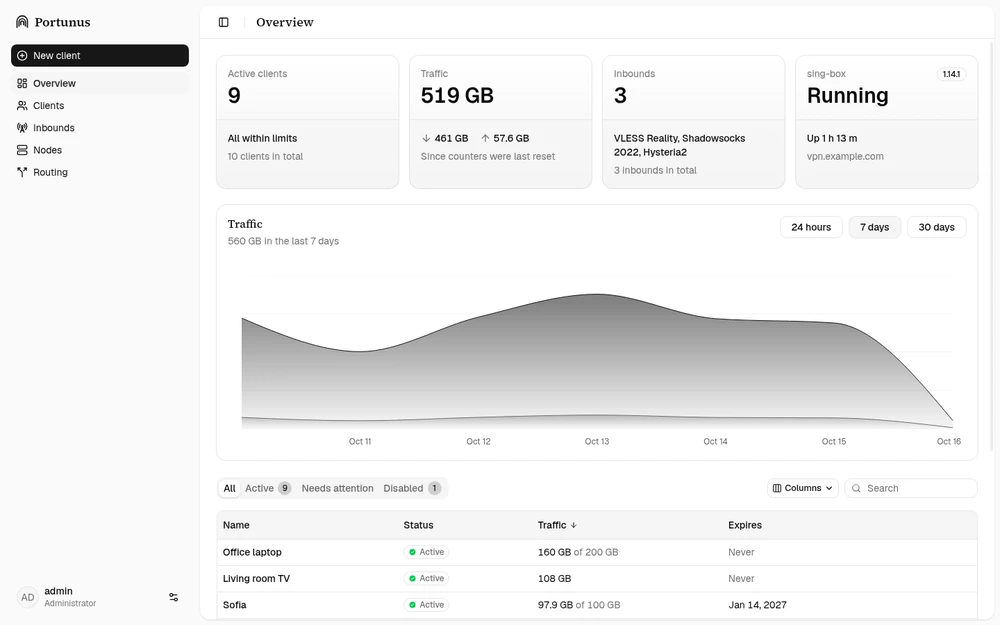
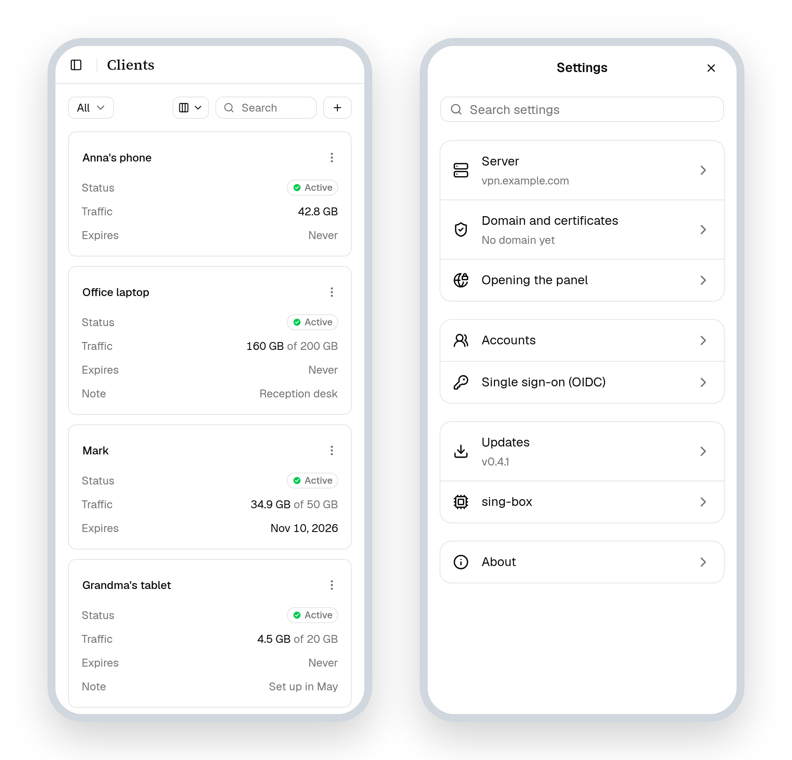

<div align="center">

<picture>
  <source media="(prefers-color-scheme: dark)" srcset=".github/assets/icon-light.svg">
  
</picture>

# Portunus

**A light, self-hosted panel for [sing-box](https://sing-box.sagernet.org).**<br>
Connections, clients, exit servers and routing on one server, from a browser or a phone.

[](LICENSE)


</div>

<br>

<picture>
  <source media="(prefers-color-scheme: dark)" type="image/avif" srcset=".github/assets/demo-dark.avif">
  <source media="(prefers-color-scheme: dark)" srcset=".github/assets/demo-dark.webp">
  <source type="image/avif" srcset=".github/assets/demo-light.avif">
  
</picture>

## Why Portunus

- **One container, one command.** The panel and sing-box in a ~93 MB image
  that idles at ~15 MB of memory. Made for a 1 vCPU / 1 GB server.
- **Hidden by default.** The panel listens on loopback only and is reached
  through an SSH tunnel. Opened by its domain, it answers strangers with an
  ordinary website, and only a secret address lets a browser in.
- **Every modern protocol.** VLESS + REALITY, Hysteria2, TUIC, Trojan and
  Shadowsocks 2022, set up by a wizard that checks the port, the camouflage
  site and the certificate before anything goes live.
- **Clients that look after themselves.** Traffic limits, expiry dates,
  subscriptions that apps refresh on their own, and a QR code for every
  connection.
- **More servers with one pasted command.** Exit servers on the map, backup
  entries, and standby copies of the panel that can take over if the main
  server is lost.
- **Routing by lists.** Send sites straight out, through a chosen server, or
  nowhere, from your own lists or ones fetched by link.
- **Certificates handled.** Let's Encrypt for your domain, moving to another
  domain in one step, and a certificate authority of its own for the rest.
- **Accounts and single sign-on.** Administrators, operators and viewers,
  with sign-in through any OpenID Connect provider.
- **Updates from the panel.** A newer release is installed with a click or
  on a schedule, and the nodes follow.

<br>

<div align="center">

<picture>
  <source media="(prefers-color-scheme: dark)" srcset=".github/assets/phones-dark.png">
  
</picture>

<sub>And on a phone: tables become cards, and the settings a list of sections.</sub>

</div>

## Quick start

On a Linux server with Docker:

```sh
curl -fsSLO https://raw.githubusercontent.com/Portunus-org/Portunus/main/docker-compose.yml
docker compose up -d
docker compose logs portunus     # the address, the login and a first password
```

Then, from your computer:

```sh
ssh -N -L 2053:127.0.0.1:2053 user@your-server
```

and open <http://localhost:2053>. The first sign-in walks you through the
rest: your password, the server's address or domain, a first connection and
a first client.

Everything else, from ports and firewalls to backups, is in
[docs/DEPLOY.md](docs/DEPLOY.md).

## Documentation

The guide for everyday use is built into the panel (**Help** in the user
menu): protocols, certificates, clients and subscriptions, apps, nodes,
troubleshooting. The files here cover running it and how it is made.

| | |
|---|---|
| [Deployment](docs/DEPLOY.md) | Installing, configuring, updating, backups |
| [Security](docs/SECURITY.md) | What is protected and how |
| [Architecture](docs/ARCHITECTURE.md) | How the parts fit together |
| [Decisions](docs/DECISIONS.md) | Why things are the way they are |
| [Design](docs/DESIGN.md) | The interface's rules |

## License

Portunus is free software under the [GNU Affero General Public License v3.0](LICENSE).
